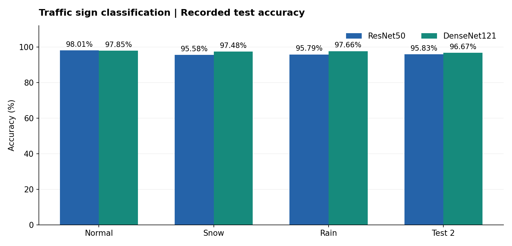
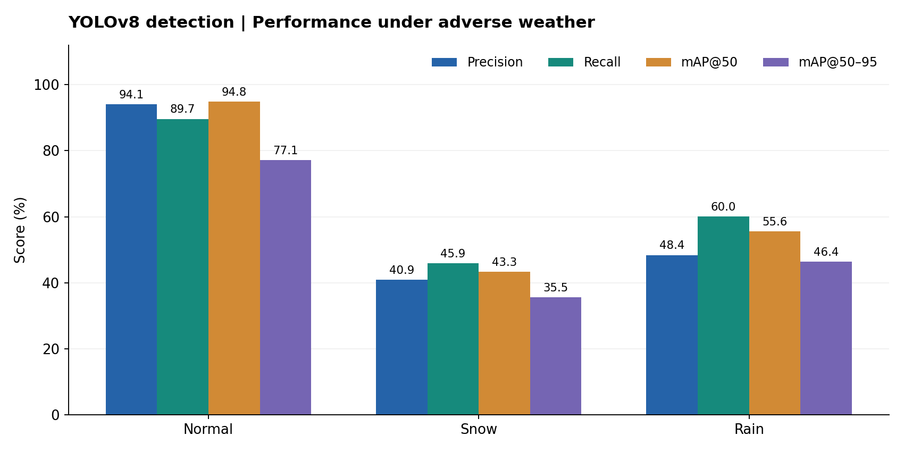
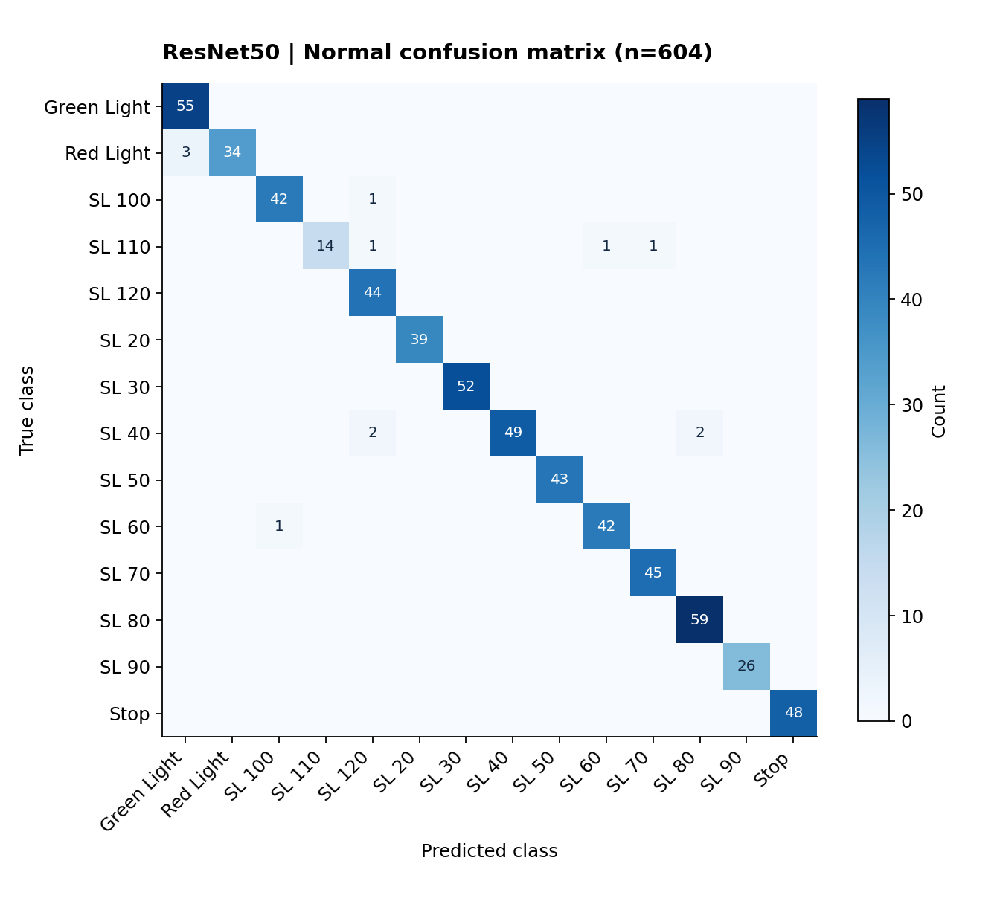
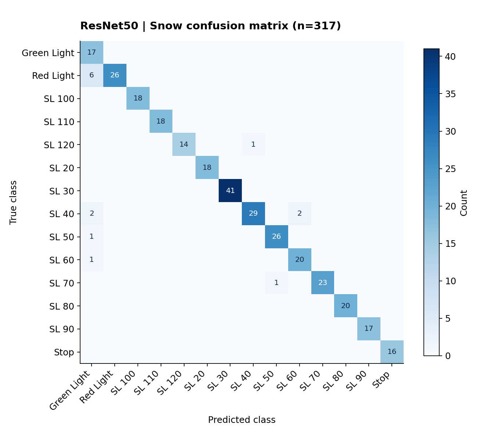
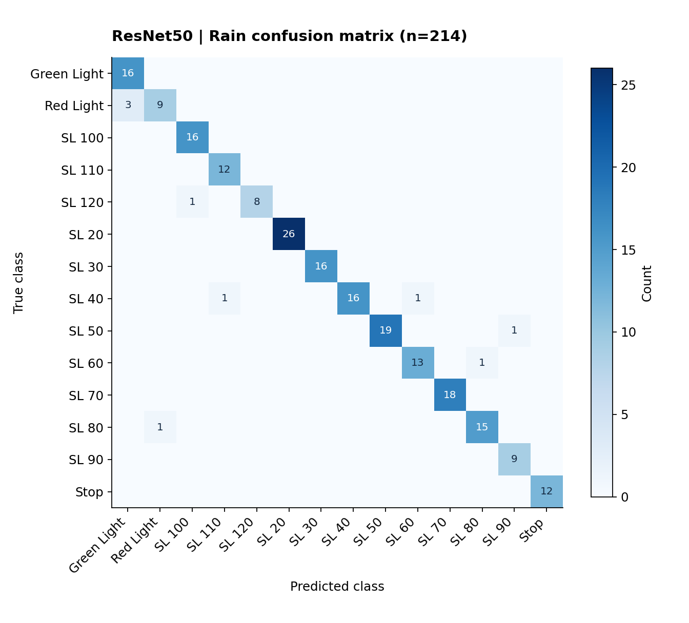
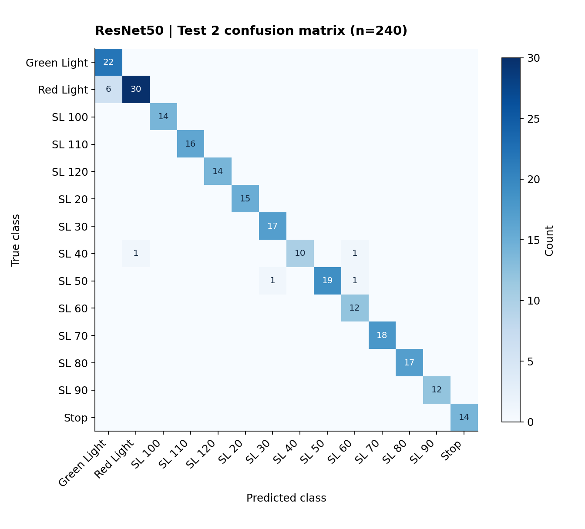
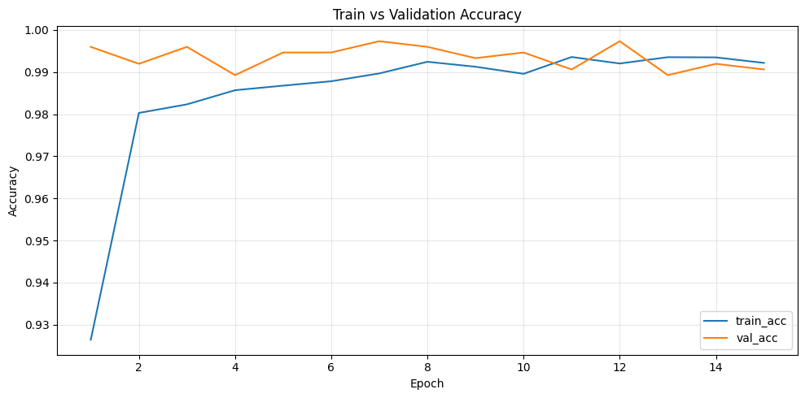
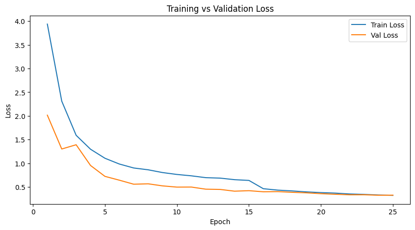

# Traffic Sign Detection and Recognition under Adverse Weather Conditions

Computer vision experiments comparing YOLOv8 object detection with ResNet50 and DenseNet121 classification on normal, snowy and rainy traffic scenes. The classifiers operate on cropped traffic signs; their accuracy is not directly comparable with detection mAP.

## Recorded results

| Test split | Images (classification) | ResNet50 accuracy | DenseNet121 accuracy | YOLO mAP50 |
|---|---:|---:|---:|---:|
| Normal | 604 | 98.01% | 97.85% | 94.84% |
| Snow | 317 | 95.58% | 97.48% | 43.33% |
| Rain | 214 | 95.79% | 97.66% | 55.65% |
| Test2 | 240 | 95.83% | 96.67% | Not verified |

The detection CSV retains the original Test2 value (identical to Normal). The original evaluation used the same YAML for both splits, so this result should not be treated as independent evidence. The new evaluation creates a dedicated test path for each split. No new metrics have been claimed. The original YOLOv13-named notebook actually called YOLOv8; this repository does not claim YOLOv13 results.

## Visual results

### Classification robustness



DenseNet121 retains higher recorded accuracy than ResNet50 on the snow and rain splits. These are cropped-sign classification results, not full-scene detection results.

### Object detection performance



Snow and rain substantially reduce the recorded detection scores. Test2 is excluded from this figure because its recorded metrics duplicate the normal split and are not independently verified.

### Confusion matrices — ResNet50

| Normal | Snow |
| --- | --- |
|  |  |
| **Rain** | **Test 2** |
|  |  |

Matrices reconstructed from the archived per-class reports; every row total was checked against its original support. Zero cells are blank. A particularly important failure mode is red-light images being classified as green: 3/37 normal, 6/32 snow, 3/12 rain and 6/36 Test2.

### Archived training curves

| DenseNet121 training/validation accuracy | YOLOv8 classification loss |
| --- | --- |
|  |  |

These plots were extracted from the original notebook outputs, not generated by rerunning training. A [second DenseNet121 checkpoint plot](assets/densenet_checkpoint_accuracy.png) is also preserved. They document historical experiments and do not establish the exact checkpoint used by every test.

### Qualitative detection examples

Original annotated prediction images are not included in this archive. To produce examples with authorized images and the matching trained checkpoint:

```bash
yolo predict model=weights/yolov8_best.pt source=data/TrafficSignDataset/snow_test/images imgsz=960 save=True project=runs name=snow_examples
```

Inspect the generated images and confirm redistribution rights before adding selected examples to the repository.

## Setup

Python 3.10+; a compatible PyTorch/torchvision installation, preferably with CUDA for training. From the repository root:

```bash
python -m pip install -r requirements.txt
```

Data and checkpoints are not committed. Use your authorized local copies of the original datasets. Expected layout:

```text
data/TrafficSignDataset/
  data.yaml, datamix.yaml
  train_mix/images, train_mix/labels
  valid/images, valid/labels
  test/, snow_test/, rainy_test/, test2/  # each has images/ and labels/
data/resnet_dataset2/
  train_mix/, val/, test/, snow_test/, rainy_test/, test2/
  # each split contains one folder per class
weights/
  resnet_checkpoint.pth
  densenet_best.pt
  yolov8_best.pt
```

The classifier ignores Speed Limit 10 and uses the training split to fix the class order. Check that your legacy checkpoint uses that exact order. The original detector weights must be selected from the desired experiment; the filename above is a local example, not a supplied checkpoint. Review the dataset YAML and replace old absolute Colab paths with relative paths rooted at your dataset before training.

## Usage

```bash
python src/prepare_dataset.py --data data/TrafficSignDataset --out data/resnet_dataset2
python src/classify.py evaluate --model densenet121 --data data/resnet_dataset2 --weights weights/densenet_best.pt --out runs/densenet121
python src/classify.py evaluate --model resnet50 --data data/resnet_dataset2 --weights weights/resnet_checkpoint.pth --out runs/resnet50
python src/detect.py evaluate --data data/TrafficSignDataset --weights weights/yolov8_best.pt --ignore-speed-limit-10
```

Optional fresh training (choose a new checkpoint name):

```bash
python src/classify.py train --model densenet121 --data data/resnet_dataset2 --weights weights/densenet_new.pt
python src/detect.py train --data data/TrafficSignDataset --weights yolov8n.pt
```

`notebooks/workflow.ipynb` provides a notebook entry point. `results/` contains the original DenseNet summary, ResNet per-class reports and derived aggregate accuracy, and the original detection metrics with private paths removed. Results were recovered from archived outputs, not rerun. Red-to-green light misclassification is a safety-relevant limitation; this is research code, not a validated driving system.

## Refactoring notes

The final CLI consolidates notebook experiments, retains model-specific preprocessing and core settings, and introduces consistent split mapping, explicit paths and checkpoint loading. The new training loop uses best validation accuracy for both classifiers, so it is not an exact replay of every historical run. Dataset preparation is a consolidated crop workflow rather than an exact reconstruction of all historical augmentation. Original dependency versions were not established; requirements are unpinned. Python syntax and notebook structure were checked; full model training and checkpoint inference require the external data and weights and have not been run.

Only publish datasets and trained weights if their licenses and provenance allow redistribution. No open-source license is assigned without the author's approval.
